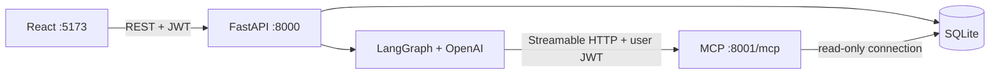

# iBank Demo

A locally runnable fictional retail bank showing **React → FastAPI → LangGraph → authenticated MCP → read-only SQLite**. The UI includes Dashboard, Transactions, Cards, Offers and Chatbot. No real banking connections or ICICI assets are used.

## Run locally

Prerequisites: Python 3.11+ and Node 20.19+ (or 22.12+), npm, and make. Python 3.14 and Node 25 were used for verification.

```sh
make setup
cp .env.example .env
# Edit .env: set OPENAI_API_KEY and replace JWT_SECRET with a random secret.
make seed
make dev
```

Open **http://127.0.0.1:5173**. The banking views work without an OpenAI key. Chat requires a valid server-side `OPENAI_API_KEY`, network access to OpenAI, and the MCP process. Missing configuration produces a friendly assistant error instead of fabricated answers. Never put the key in a `VITE_` variable.

`make seed` recreates the fictional database. Stop services before reseeding. `make dev` starts all three processes; Ctrl+C stops them. Alternatively run `make run-mcp`, `make run-backend`, and `make run-frontend` in separate terminals. Backend API docs: http://127.0.0.1:8000/docs. MCP: http://127.0.0.1:8001/mcp.

| Full name | Username | Password | City |
| --- | --- | --- | --- |
| Aarav Sharma | `aarav.sharma` | `Aarav@123` | Mumbai |
| Priya Iyer | `priya.iyer` | `Priya@123` | Chennai |
| Rohan Mehta | `rohan.mehta` | `Rohan@123` | Ahmedabad |
| Ananya Reddy | `ananya.reddy` | `Ananya@123` | Hyderabad |
| Vikram Singh Rathore | `vikram.rathore` | `Vikram@123` | Jaipur |

The login page also has a collapsible demo account picker.

## Configuration

| Variable | Purpose |
| --- | --- |
| `OPENAI_API_KEY` | OpenAI API key; server only, needed for chat |
| `OPENAI_MODEL` | Defaults to `gpt-4o-mini` |
| `JWT_SECRET` | Shared HS256 signing secret for backend and MCP; replace demo default |
| `DB_PATH` | Defaults to `data/bank.db`; relative to repository working directory |
| `MCP_URL` | Defaults to `http://127.0.0.1:8001/mcp` |

Copy `.env.example` to `.env`; `.env`, database, installed dependencies and build output are ignored. JWTs expire in 60 minutes. The browser stores the token in sessionStorage for this demo. All processes bind to loopback; this implementation is intended for local use.

## Architecture



- Five customers; each has one savings account, debit card, credit card, 48 account transactions, 32 credit transactions and one unpaid statement. Eighteen fictional offers include two expired ones.
- Money is stored as integer paise. Responses use rupee numbers and INR currency. Account balances reconcile with the final transaction; credit available limit reconciles with current outstanding.
- Seed uses random seed 42 and relative dates. Each customer's latest anchors are Swiggy ₹642 and Amazon ₹4,899 on credit. Password hashes use fresh bcrypt salts, so hashes differ across seed runs.
- MCP exposes **exactly three tools**: `get_banking_transactions`, `get_credit_card_transactions`, `get_available_offers`. Their schemas never accept customer/account IDs. A pure ASGI authentication wrapper validates the bearer token on every request and uses request context to scope parameterized SQL. MCP connections use SQLite `mode=ro`.
- The agent loads tools using `MultiServerMCPClient` per request and forwards the user's token in HTTP headers. The OpenAI model sees tools and results, not JWTs. A shared in-memory LangGraph checkpointer keeps history under `customer_id:session_id`. A per-thread lock serializes questions. New chat creates a new session. Restarting the backend clears chat memory.
- Up to six tool rounds per question. System instructions require grounded answers, Indian INR formatting, refusal of writes and other customers' data. Tool summaries cover returned rows only and flag truncation. The assistant must disclose partial totals instead of guessing.
- REST transaction filters match MCP filters. REST supports `source=account|credit`, `page` and `limit` (max 50). Dashboard category totals aggregate all spending over the last 30 days.

## Verification

```sh
make test
make build
```

Tests use a temporary database, real MCP over HTTP, and a fake model for LangGraph. They exercise seed counts, account reconciliation, credentials, protected endpoints, filter validation, summary amounts, offer eligibility, read-only access, customer isolation, graph tool execution, session memory, chat error mapping and UI login/chat flows. No paid LLM requests are made by automated tests. Version snapshots are recorded in `requirements.lock.txt` and `frontend/package-lock.json`; use `pip install -r requirements.lock.txt` to reproduce the tested Python versions.

The manual real-model checklist and verification limits are in [docs/eval-results.md](docs/eval-results.md).

## Troubleshooting

- **Assistant unavailable:** ensure `make run-mcp` is running, `.env` has a valid OpenAI key and model, and `MCP_URL` is correct. Restart backend after editing `.env`.
- **401 / session expired:** sign in again. Both services must use the same JWT secret.
- **Database missing:** run `make seed` from the repository root.
- **Port in use:** stop the existing service on 5173, 8000 or 8001. Vite proxy targets backend port 8000.
- **MCP called directly:** send `Authorization: Bearer <access_token>` obtained from `/api/auth/login`; raw browser navigation is not an MCP client.

This is a read-only local reference demo. Memory and conversation locks live in process memory; sessions are not persisted, and the demo does not implement production session eviction or deployment hardening.

## Push to GitHub

Create an empty GitHub repository, then run from this directory:

```sh
git add .
git diff --cached --stat
git commit -m "Initial iBank Demo implementation"
git remote add origin https://github.com/YOUR_USERNAME/YOUR_REPOSITORY.git
git push -u origin main
```

Before committing, confirm `git check-ignore .env data/bank.db` lists both files. Keep `.env` and database files local; only `.env.example` belongs in Git. The credentials documented above are intentionally fictional demo credentials. On a fresh clone, follow the setup steps above to install dependencies and regenerate the database.
