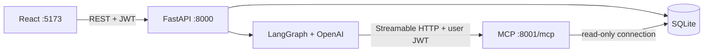

# iBank Demo

A fictional retail bank that runs locally or as a complete Vercel app, showing **React → FastAPI → LangGraph → authenticated MCP → read-only SQLite**. The UI includes Dashboard, Transactions, Cards, Offers and Chatbot. No real banking connections or ICICI assets are used.

## Run locally

Prerequisites: Python 3.12+ and Node 20.19+ (or 22.12+), npm, and make. Python 3.14 and Node 25 were used for verification.

```sh
make setup
cp .env.example .env
# Edit .env: set OPENAI_API_KEY and replace JWT_SECRET with a random secret.
make seed
make dev
```

Open **http://127.0.0.1:5173**. The banking views work without an OpenAI key. Chat requires a valid server-side `OPENAI_API_KEY`, network access to OpenAI, and the MCP process. Missing configuration produces a friendly assistant error instead of fabricated answers. Never put the key in a `VITE_` variable.

`make seed` recreates the fictional database. Stop services before reseeding. `make dev` starts all three processes; Ctrl+C stops them. Alternatively run `make run-mcp`, `make run-backend`, and `make run-frontend` in separate terminals. Backend API docs: http://127.0.0.1:8000/docs. MCP: http://127.0.0.1:8001/mcp.

| Full name | Username | Password | City |
| --- | --- | --- | --- |
| Aarav Sharma | `aarav.sharma` | `Aarav@123` | Mumbai |
| Priya Iyer | `priya.iyer` | `Priya@123` | Chennai |
| Rohan Mehta | `rohan.mehta` | `Rohan@123` | Ahmedabad |
| Ananya Reddy | `ananya.reddy` | `Ananya@123` | Hyderabad |
| Vikram Singh Rathore | `vikram.rathore` | `Vikram@123` | Jaipur |

The login page also has a collapsible demo account picker.

## Configuration

| Variable | Purpose |
| --- | --- |
| `OPENAI_API_KEY` | OpenAI API key; server only, needed for chat |
| `OPENAI_MODEL` | Defaults to `gpt-4o-mini` |
| `JWT_SECRET` | Shared HS256 signing secret for backend and MCP; replace demo default |
| `DB_PATH` | Defaults to `data/bank.db`; relative to repository working directory |
| `MCP_URL` | Defaults to `http://127.0.0.1:8001/mcp` |

Copy `.env.example` to `.env`; `.env`, database, installed dependencies and build output are ignored. JWTs expire in 60 minutes. The browser stores the token in sessionStorage for this demo. Local processes bind to loopback. For hosted deployment, use the Vercel instructions below.

## Architecture



- Five customers; each has one savings account, debit card, credit card, 48 account transactions, 32 credit transactions and one unpaid statement. Eighteen fictional offers include two expired ones.
- Money is stored as integer paise. Responses use rupee numbers and INR currency. Account balances reconcile with the final transaction; credit available limit reconciles with current outstanding.
- Seed uses random seed 42 and relative dates. Each customer's latest anchors are Swiggy ₹642 and Amazon ₹4,899 on credit. Password hashes use fresh bcrypt salts, so hashes differ across seed runs.
- MCP exposes **exactly three tools**: `get_banking_transactions`, `get_credit_card_transactions`, `get_available_offers`. Their schemas never accept customer/account IDs. A pure ASGI authentication wrapper validates the bearer token on every request and uses request context to scope parameterized SQL. MCP connections use SQLite `mode=ro`.
- The agent loads tools using `MultiServerMCPClient` per request and forwards the user's token in HTTP headers. The OpenAI model sees tools and results, not JWTs. A shared in-memory LangGraph checkpointer keeps history under `customer_id:session_id`. A per-thread lock serializes questions. New chat creates a new session. Restarting the backend clears chat memory.
- Up to six tool rounds per question. System instructions require grounded answers, Indian INR formatting, refusal of writes and other customers' data. Tool summaries cover returned rows only and flag truncation. The assistant must disclose partial totals instead of guessing.
- REST transaction filters match MCP filters. REST supports `source=account|credit`, `page` and `limit` (max 50). Dashboard category totals aggregate all spending over the last 30 days.

## Verification

```sh
make test
make build
```

Tests use a temporary database, real MCP over HTTP, and a fake model for LangGraph. They exercise seed counts, account reconciliation, credentials, protected endpoints, filter validation, summary amounts, offer eligibility, read-only access, customer isolation, graph tool execution, session memory, chat error mapping and UI login/chat flows. No paid LLM requests are made by automated tests. Vercel uses the project dependencies in `pyproject.toml` and `uv.lock`. Keep `pyproject.toml` dependencies aligned with `requirements.txt`. Local version snapshots are recorded in `requirements.lock.txt` and `frontend/package-lock.json`; use `pip install -r requirements.lock.txt` to reproduce the tested Python versions.

The manual real-model checklist and verification limits are in [docs/eval-results.md](docs/eval-results.md).

## Troubleshooting

- **Assistant unavailable:** ensure `make run-mcp` is running, `.env` has a valid OpenAI key and model, and `MCP_URL` is correct. Restart backend after editing `.env`.
- **401 / session expired:** sign in again. Both services must use the same JWT secret.
- **Database missing:** run `make seed` from the repository root.
- **Port in use:** stop the existing service on 5173, 8000 or 8001. Vite proxy targets backend port 8000.
- **MCP called directly:** send `Authorization: Bearer <access_token>` obtained from `/api/auth/login`; raw browser navigation is not an MCP client.

This is a read-only local reference demo. Memory and conversation locks live in process memory; sessions are not persisted, and the demo does not implement production session eviction or deployment hardening.

## Push to GitHub

Create an empty GitHub repository, then run from this directory:

```sh
git add .
git diff --cached --stat
git commit -m "Initial iBank Demo implementation"
git remote add origin https://github.com/YOUR_USERNAME/YOUR_REPOSITORY.git
git push -u origin main
```

Before committing, confirm `git check-ignore .env data/bank.db` lists both files. Keep `.env` and database files local; only `.env.example` belongs in Git. The credentials documented above are intentionally fictional demo credentials. On a fresh clone, follow the setup steps above to install dependencies and regenerate the database.

## Deploy the complete app to Vercel

The root `main.py` exports one FastAPI application serving the React build, REST API and authenticated MCP endpoint. Use **the repository root**, not `frontend`, as the Vercel Root Directory. Do not configure the project as a Vite-only site.

1. Commit and push the deployment changes to GitHub.
2. In Vercel choose **Add New → Project** and import `ai-ml-engineering-catalogue/banking_agent`.
3. Set **Root Directory** to the repository root (leave the field empty or use `.`), **Framework Preset** to **FastAPI**, and **Node.js Version** to **22.x**. Leave Install Command and Output Directory on their defaults. The root `vercel.json` sets the build command; remove old Vite dashboard overrides if this project was previously configured for frontend-only deployment.
4. Add server-side environment variables for both Preview and Production:

   | Variable | Value |
   | --- | --- |
   | `OPENAI_API_KEY` | Your OpenAI API key |
   | `OPENAI_MODEL` | `gpt-4o-mini` or your chosen OpenAI model |
   | `JWT_SECRET` | A randomly generated secret, at least 32 characters |

   Generate a secret locally with `.venv/bin/python -c "import secrets; print(secrets.token_urlsafe(48))"`. Store it in Vercel settings, not in Git. Do not prefix these variables with `VITE_`. Do **not** copy local `DB_PATH=data/bank.db` or `MCP_URL` into Vercel; leave both unset.
5. Deploy. Vercel installs Python requirements, builds React using `npm ci --prefix frontend && npm run build --prefix frontend`, and uses Python 3.12 from `.python-version`.
6. Open the deployment URL and log in using a demo account. Verify Dashboard, Cards, Offers, `/chatbot` refresh, a question such as “Show my last 5 UPI payments”, and a follow-up. Without an OpenAI key, banking views work but chat reports unavailable.

No separate backend hosting, database service, or MCP process is required for this read-only demo. Vercel sets `VERCEL=1`, which selects the serverless behavior automatically:

- Each instance seeds a fictional SQLite snapshot on first data access under `/tmp/ibank-demo/bank.db`. Initialization uses a lock and atomic replacement; banking and MCP queries still open it read-only. No real data is stored. The first request incurs seed time. Instances can be discarded and recreated, and their snapshots are not durable. Seed dates follow each instance's initialization date, so recent data can differ across long-lived instances around date boundaries.
- The LangGraph agent still loads the exact three MCP tools with `MultiServerMCPClient` and sends the bearer JWT. Its HTTP client uses an in-process ASGI transport instead of calling another function or spawning a server.
- A hosted MCP client can connect to `https://YOUR_DEPLOYMENT/mcp/` with a bearer token. The endpoint runs a stateless MCP server per request. Vercel deployment protection may additionally require platform access for external clients; the internal chat path does not depend on public self-requests.
- Conversation context is an encrypted, authenticated token carried by the chat UI. It contains only recent user/assistant turns, is bound to customer and session, expires after an hour, and does not depend on instance memory. Up to six recent turns are retained, with a size cap. Prior answers are context, and banking facts must be fetched again. New chat clears this token. Refreshing or leaving the chat page clears UI history, as in local mode.
- A random hosted JWT secret is required. The demo fallback is rejected. Rotating it invalidates existing login and conversation tokens.
- `maxDuration` is set to 300 seconds in `vercel.json`; your Vercel plan must support that setting. Model latency and platform execution limits can still cause a chat timeout. This is a fictional read-only demo, not production banking infrastructure.

For a custom domain used by external MCP clients, set `MCP_ALLOWED_HOSTS` to a comma-separated list of hostnames (no URL scheme), for example `bank.example.com`. The default deployment and production domains are read from Vercel system variables. Host/origin checks remain enabled.

### Preview the single-app entry point locally

After `make build`, run:

```sh
VERCEL=1 DB_PATH=/tmp/ibank-demo-preview/bank.db .venv/bin/python -m uvicorn main:app --host 127.0.0.1 --port 8000
```

Ensure your local `.env` has a random JWT secret of at least 32 characters. Open `http://127.0.0.1:8000`; no separate MCP or Vite process is needed in this mode. Regular `make dev` retains the original three-service architecture.

Vercel reference: [FastAPI entry points, frontend serving and function configuration](https://vercel.com/docs/frameworks/backend/fastapi).
